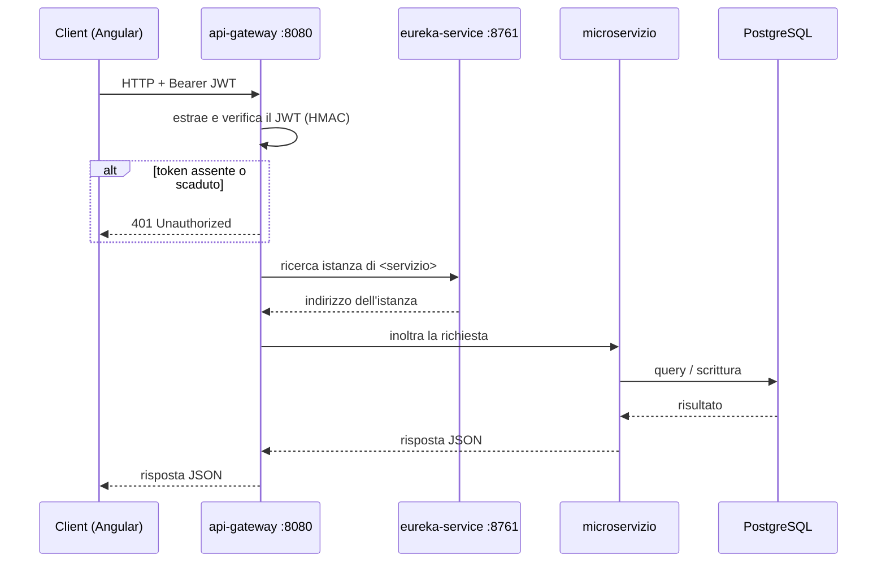
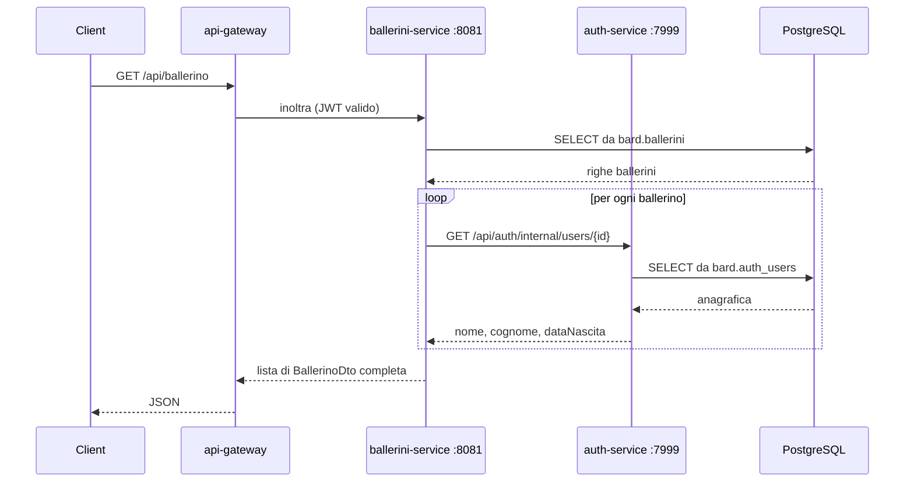

# BARD Backend

Backend della piattaforma **BARD** (CHRONOS): autenticazione, anagrafica ballerini e
gestione delle presenze, esposti da un API Gateway e orchestrati da Eureka.

È una **mono-repo Maven multi-module** (`io.bard:bard-parent`): tutti i servizi
condividono lo stesso stack — **Java 21**, **Spring Boot 4.1.1**, **PostgreSQL**.

---

## Indice

- [Architettura](#architettura)
- [Flusso delle informazioni](#flusso-delle-informazioni)
- [I moduli](#i-moduli)
- [Tecnologie](#tecnologie)
- [Uso](#uso)
- [Avvio](#avvio)

---

## Architettura

```
                          ┌─────────────────┐
                          │   bard-front    │  Angular 21 (4200)
                          └────────┬────────┘
                                   │ HTTP / JSON
                                   ▼
                          ┌─────────────────┐
                          │   api-gateway   │  Spring Cloud Gateway · WebFlux (8080)
                          │  ─────────────  │
                          │ • valida JWT    │
                          │ • routing lb:// │◄──────────────┐
                          │ • CORS          │               │ service discovery
                          └────────┬────────┘               │
                    ┌──────────────┼──────────────┐         │
                    ▼              ▼              ▼         │
            ┌──────────────┐ ┌──────────────┐ ┌───────────────┐
            │ auth-service │ │ ballerini-svc│ │ presenza-svc  │
            │   (7999)     │ │   (8081)     │ │    (8082)     │
            └──────┬───────┘ └──────┬───────┘ └───────┬───────┘
                   │                │                 │
                   │  anagrafica    │                 │
                   │◄───────────────┘                 │
                   │  HTTP interno                    │
                   ▼                                  ▼
            ┌──────────────────────────────────────────────┐
            │              PostgreSQL · schema `bard`       │
            │  auth_users · auth_roles · auth_user_roles    │
            │  ballerini · presenza                         │
            └──────────────────────────────────────────────┘
                                   ▲
                                   │ registrazione
                          ┌────────┴────────┐
                          │ eureka-service  │  Netflix Eureka (8761)
                          └─────────────────┘
```

### Come funziona

1. **Ingresso unico** — il client parla solo con `api-gateway` (8080). Nessun servizio
   è esposto direttamente all'esterno.
2. **Autenticazione** — il gateway intercetta la richiesta, estrae il `Bearer` token e
   lo verifica con la stessa chiave HMAC usata da `auth-service` (`CHRONOS_JWT_SECRET`).
   Login e registrazione sono gli unici endpoint pubblici.
3. **Service discovery** — prima di instradare, il gateway chiede a `eureka-service`
   l'indirizzo dell'istanza attiva e instrada con `lb://<nome-servizio>`.
4. **Elaborazione** — il microservizio esegue la logica e persiste su PostgreSQL.
5. **Composizione** — `ballerini-service` non ha i dati anagrafici: quando compone un
   ballerino chiama internamente `auth-service` (`/api/auth/internal/users/{id}`).

---

## Flusso delle informazioni

### Sequenza di una richiesta autenticata



### Composizione del ballerino (dato incrociato)



> **Nota**: il `loop` evidenzia il limite attuale: per *N* ballerini vengono fatte
> *N* chiamate HTTP a `auth-service`. È il punto su cui intervenire per il futuro
> (vedi `docs/piani/2026-11-06_235000-dto-compositi-n-plus-1.md`).

---

## I moduli

| Modulo | Ruolo | Porta | Responsabilità |
|---|---|---|---|
| `api-gateway` | Ingresso | 8080 | Routing, validazione JWT, CORS |
| `eureka-service` | Registro | 8761 | Service discovery (`lb://`) |
| `auth-service` | Identità | 7999 | Registrazione, login, JWT, ruoli, anagrafica |
| `ballerini-service` | Profilo | 8081 | CRUD ballerini + composizione anagrafica |
| `presenza-service` | Presenze | 8082 | CRUD presenze, osservabilità |
| `bard-common` | Condiviso | — | Entità JPA usate da più servizi |

### Rotte esposte dal gateway

| Prefisso | Destinazione |
|---|---|
| `/api/auth/**` | `lb://AUTH-SERVICE` |
| `/api/ballerino/**` | `lb://ballerini-service` |
| `/api/presenza/**` | `lb://presenza-service` |

### Endpoint dei microservizi

| Servizio | Metodo | Path | Descrizione |
|---|---|---|---|
| auth | POST | `/api/auth/register` | Registrazione (pubblico) |
| auth | POST | `/api/auth/login` | Login → JWT (pubblico) |
| auth | GET | `/api/auth/me` | Profilo dell'utente corrente |
| auth | GET | `/api/auth/internal/users/{id}` | Anagrafica (solo rete interna) |
| ballerini | POST | `/api/ballerino` | Crea ballerino |
| ballerini | GET | `/api/ballerino` | Lista ballerini |
| ballerini | PUT | `/api/ballerino` | Aggiorna ballerino |
| ballerini | DELETE | `/api/ballerino/{id}` | Elimina ballerino |
| presenza | POST | `/api/presenza` | Registra presenza |
| presenza | PUT | `/api/presenza` | Aggiorna presenza |
| presenza | GET | `/api/presenza/{id}` | Presenze di un ballerino |
| presenza | DELETE | `/api/presenza/{id}` | Elimina presenza |

---

## Tecnologie

| Area | Tecnologia | Dove |
|---|---|---|
| Linguaggio | **Java 21** | tutti i servizi |
| Framework | **Spring Boot 4.1.1** | tutti i servizi |
| Cloud | **Spring Cloud 2025.1.3** | gateway, Eureka |
| Web reattivo | **Spring WebFlux** | `api-gateway` |
| Web MVC | **Spring WebMVC** | auth, ballerini, presenza |
| Service discovery | **Netflix Eureka** | `eureka-service` |
| Sicurezza | **Spring Security + JWT** (jjwt) | gateway, auth |
| Persistenza | **Spring Data JPA + Hibernate** | auth, ballerini, presenza |
| Database | **PostgreSQL** (schema `bard`) | tutti i servizi dati |
| Validazione | **Bean Validation** (Hibernate Validator) | DTO in ingresso |
| Mapping | **ModelMapper**, **Lombok** | ballerini, entità |
| API docs | **springdoc-openapi** (Swagger UI) | presenza |
| Osservabilità | **OpenTelemetry** (OTLP → `:4318`) | presenza |
| Messagistica | **Apache Kafka** (configurato, non attivo) | auth |
| Build | **Maven** multi-module | mono-repo |

---

## Uso

### Prerequisiti

- **Java 21** (`JAVA_HOME=/usr/lib/jvm/java-21-openjdk-amd64`)
- **PostgreSQL** raggiungibile, con lo schema `bard` creato da `sql/schema.sql`
- **Maven** 3.9+

### Avvio dell'infrastruttura

```bash
# 1. crea lo schema (una tantum)
psql -h <host> -U <user> -d postgres -c "CREATE SCHEMA bard;"
psql -h <host> -U <user> -d postgres -f sql/schema.sql
```

### Avvio dei servizi

```bash
cd Bard-backend
export JAVA_HOME=/usr/lib/jvm/java-21-openjdk-amd64

# 1. il registry deve partire per primo
mvn spring-boot:run -pl eureka-service

# 2. i servizi applicativi (in qualsiasi ordine, in terminali separati)
mvn spring-boot:run -pl auth-service
mvn spring-boot:run -pl ballerini-service
mvn spring-boot:run -pl presenza-service

# 3. il gateway per ultimo
mvn spring-boot:run -pl gateway
```

### Variabili d'ambiente

Tutte hanno un valore di default in `application.yml` / `application.yaml`:

| Variabile | Default | Usata da |
|---|---|---|
| `DB_URL` | `jdbc:postgresql://192.168.1.22/postgres` | auth, ballerini, presenza |
| `DB_USERNAME` | `bard` | auth, ballerini, presenza |
| `DB_PASSWORD` | `0000` | auth, ballerini, presenza |
| `EUREKA_URL` | `http://localhost:8761/eureka/` | tutti |
| `CHRONOS_JWT_SECRET` | segreto di sviluppo | auth, gateway |
| `CHRONOS_JWT_EXPIRATION_MINUTES` | `120` | auth |
| `CHRONOS_FRONTEND_ORIGIN` | `http://localhost:4200` | gateway (CORS) |
| `KAFKA_BOOTSTRAP_SERVERS` | `localhost:9092` | auth |

> La stessa `CHRONOS_JWT_SECRET` **deve** essere condivisa tra `auth-service` (che firma)
> e `api-gateway` (che verifica): se differisce, ogni token viene rifiutato con 401.

### Chiamate di esempio

```bash
# registrazione
curl -X POST http://localhost:8080/api/auth/register \
  -H "Content-Type: application/json" \
  -d '{"email":"a@b.it","firstName":"A","lastName":"B","password":"segretissimo"}'

# login → restituisce il token
TOKEN=$(curl -s -X POST http://localhost:8080/api/auth/login \
  -H "Content-Type: application/json" \
  -d '{"email":"a@b.it","password":"segretissimo"}' | jq -r .token)

# chiamata autenticata
curl http://localhost:8080/api/ballerino -H "Authorization: Bearer $TOKEN"
```

---

## Avvio

Il gateway risponde su `http://localhost:8080`; il frontend Angular è configurato per
chiamare proprio quell'indirizzo (`/api/...`). Eureka è consultabile su
`http://localhost:8761` e mostra i servizi registrati.

La documentazione OpenAPI di `presenza-service` è disponibile su
`http://localhost:8082/swagger-ui.html`.
